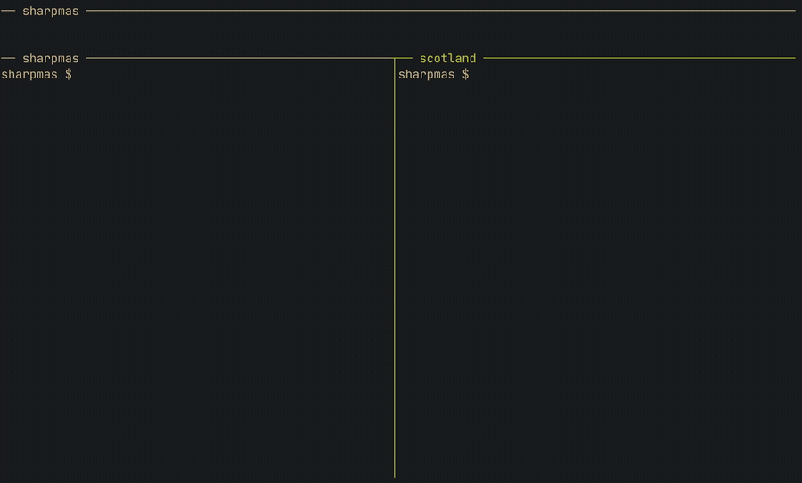

# sharpmas

Advent of Code tooling in C#, rebuilt from [rustmas](https://github.com/scadoshi/rustmas). It downloads your inputs, runs your solutions, checks the answers against an independent solver, and submits them for stars.

No solutions ship with it. Scotty's own are on the `scadoshi` branch if you want worked examples.



## Quick start

1. Copy your `session` cookie from [adventofcode.com](https://adventofcode.com) using your browser's dev tools.
2. Paste it into `.env`:

   ```sh
   cp .env.template .env    # paste the cookie into COOKIE=
   ```

3. Run it. Keep the `--`, or `dotnet run` takes the flags as its own:

   ```sh
   alias sharpmas='dotnet run --project src/Sharpmas.Cli --'

   sharpmas fetch -y 2015 -d 1              # download one puzzle into cache/
   sharpmas solve -y 2015 -d 1              # run your solution offline
   sharpmas solve -y 2015 -d 1 --validate   # check answers against the solver
   sharpmas solve -y 2015 -d 1 --submit     # check, then send for stars
   ```

A few things to know:

- Drop `-y` or `-d` to run every year or every day.
- `--submit` holds back any answer the solver disagrees with, because wrong ones cost an escalating cooldown. A puzzle the solver can't check goes through anyway.
- Add `-c Release` after the project path on brute-force days.

## Writing a day

1. Copy the template year:

   ```sh
   cp -r src/Sharpmas/Domain/Solution/YearTemplate src/Sharpmas/Domain/Solution/Year2015
   ```

2. Change the namespace in `Day01/Puzzle.cs` to `Sharpmas.Domain.Solution.Year2015.Day01`.
3. Have each part return `Answer.Solved(value)`, `new Answer.Visual(art)`, or `new Answer.None()`:

   ```csharp
   public Answer PartOne() => Answer.Solved(Input.Length.ToString());
   ```

4. Register the day in `Solvers` in `src/Sharpmas/Inbound/Solve/SolveRun.cs`:

   ```csharp
   [(2015, 1)] = Outbound.Client.Solver.Solve<Domain.Solution.Year2015.Day01.Puzzle>,
   ```

Put helpers that several days share in `Domain/Solution/Common/`.

## Reading the output

```
year 2015 day 1 in 950.7µs (35.5µs parsing)
  part one: 138 (correct) [530.9µs]
  part two: 1771 (correct) [384.3µs]
```

| Note | Meaning |
| --- | --- |
| nothing | Solved offline, unchecked |
| `correct` | The solver agrees |
| `high`, `low`, `incorrect` | The solver disagrees, so nothing was submitted |
| `new star` / `starred` | Accepted now / already solved |
| `not logged in` | Cookie missing or expired |
| `unsupported` | The solver can't do this puzzle |
| `rate limited, ...` | Advent of Code refused to grade |
| `(none)` / `(unwritten)` | No answer exists (day 25 part two) / not written yet |
| `error: ...` | The part failed; the other still ran |

A multi-day run ends with total and average parse and solve times. Timings never include the network.

Re-running `fetch` never downloads an input twice. Without a cookie, `solve` and `--validate` still work offline. More in [`context/`](context/).

## License

MIT. See [LICENSE](LICENSE).
